Apple Push Notification service (APNs) delivers remote notifications to apps on Apple platforms, including iOS, iPadOS, macOS, tvOS, and watchOS. This guide covers the Apple Developer configuration and provider-server setup required to send a test notification.

APNs is a transport, not a notification inbox. Your app registers with APNs and receives a device token; your provider server uses that token to send a request to APNs, which then attempts to deliver the notification to the device.

The system is quite complex and has a lot of different components as you can see 
in the diagram below.

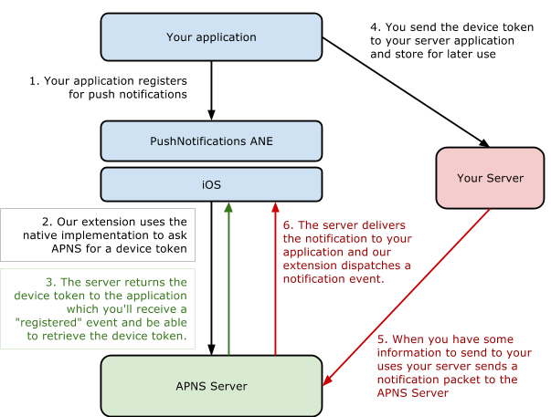

When the device finally receives the notification, the notification will be displayed 
to the user (depending on the options specified in the notification, more about these 
later). The user can then respond to the notification as they see fit, dismissing it 
or opening your application.

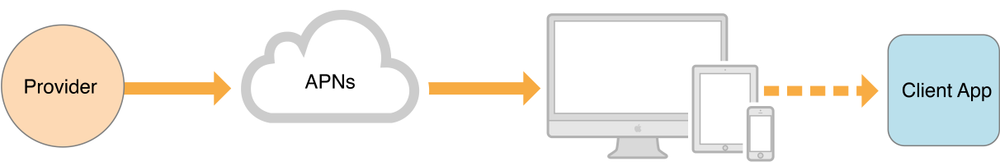

For a production app, your backend should securely store device tokens and send notifications through APNs. This guide also shows how to send a one-off test using the repository's standalone Node.js example.


## Requirements

Before starting, make sure you have:

- An Apple Developer account with access to manage App IDs, provisioning profiles, and APNs keys.
- An explicit App ID whose bundle identifier matches the app you will sign and install, with the Push Notifications capability enabled.
- An app signed with the APNs entitlement for its Apple platform.
- A network connection that allows the provider to reach APNs over HTTPS.
- Node.js 18 or later if you want to run the included test sender. The sender can run locally; you do not need to deploy a server for a one-off test.
- Keychain Access on macOS only if you use the optional legacy certificate-based flow below. The recommended `.p8` key flow is managed through the Apple Developer portal.

Use a physical device or a supported macOS app for end-to-end testing. Simulator support varies by platform and OS version; injecting a local simulator notification does not test registration with APNs or your provider-to-APNs connection.


## APNS Data Packet

An APNs request contains a small JSON payload. The `aps` dictionary controls system presentation; optional custom keys carry app-specific data. Standard remote notification payloads are limited to 4 KB, so keep them small and fetch larger or sensitive data from your backend after delivery.

```json
{
	"aps": {
		"alert": {
			"title": "A notification title",
			"body": "A notification message"
		},
		"sound": "default"
	},
	"messageId": "example-123"
}
```

The operating system uses the `aps` values to present the alert. Custom values such as `messageId` are delivered to your app for handling; they are not automatically shown to the user. Background notifications use a different push type and payload and may be delayed or omitted by the system.

For details on payload keys, see Apple's
[Creating the notification payload](https://developer.apple.com/documentation/usernotifications/generating-a-remote-notification).


## Caveats and Characteristics

APNs does not guarantee delivery or a fixed delivery time. A notification can be delayed, throttled, or not delivered, for example when a device is offline or the network blocks APNs traffic.

Additionally a device may not be able to receive a notification, for instance it 
may be on a network that blocks the ports used for push notification communication. 
Or it could be as simple as the device is switched off.

Treat notifications as a best-effort signal to refresh app state, not as durable message delivery. Avoid sending redundant notifications, and check the pricing and rate limits of any third-party push provider or backend you use. Do not put sensitive data in a notification payload; a notification can appear on a locked screen.

Review Apple's current App Store Review Guidelines before deciding how your app uses notifications.

- [Review Guidelines](https://developer.apple.com/app-store/review/guidelines/)


## Communicating with APNs


### APNs Key

For new integrations, use an APNs authentication key (`.p8`). Your provider server uses it to create a signed bearer token when connecting to APNs. The key is a server credential: never embed it in the client app. It does not replace the Push Notifications capability or entitlement required by the app.

Open the developer console and create a new Key:

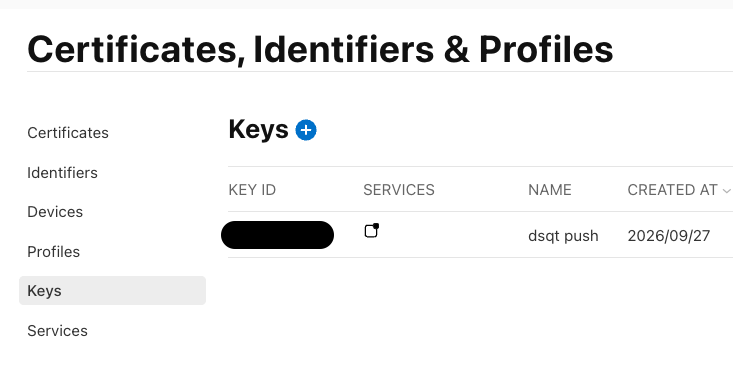

Enter a descriptive key name and enable "Apple Push Notifications service (APNs)".

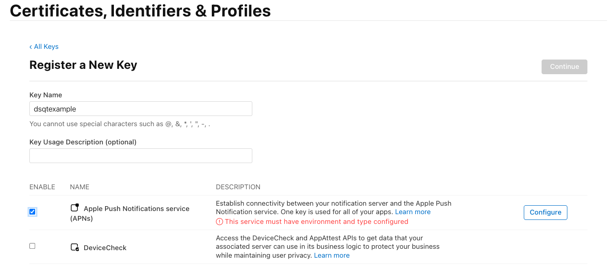

Complete the APNs key configuration if prompted, then continue to review and register the key:

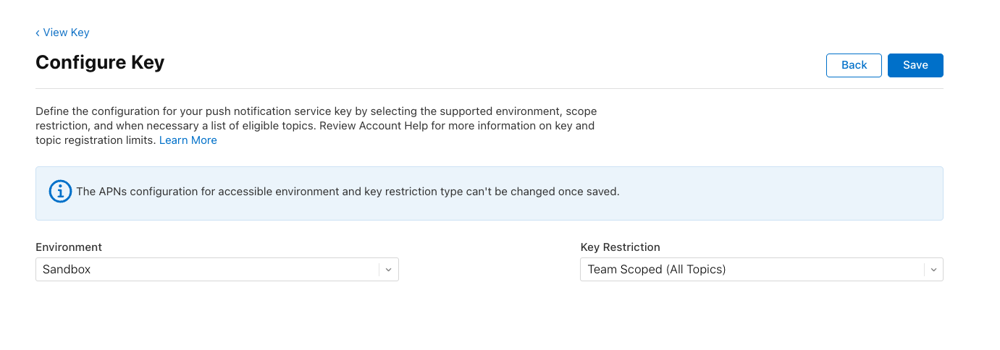

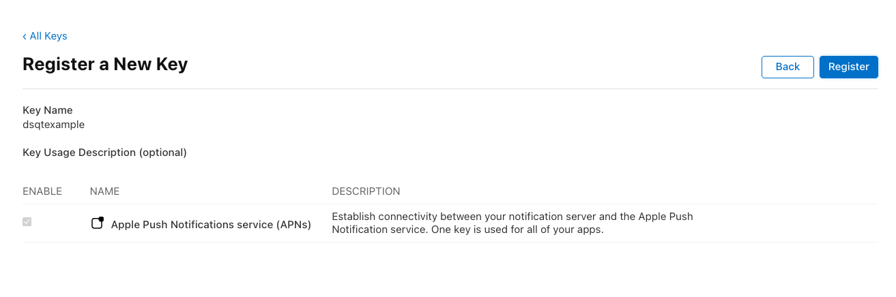

Download the `.p8` key and record its Key ID. Also record your Team ID from the Apple Developer account. The test sender uses the key, Key ID, and Team ID to create an ES256 bearer token. APNs keys can be used for multiple apps in the team, but each request must still specify the correct app topic (bundle identifier).

:::caution
The `.p8` file is only available to download once. Store it securely on the provider server and never include it in the app, source control, or a client download.
:::

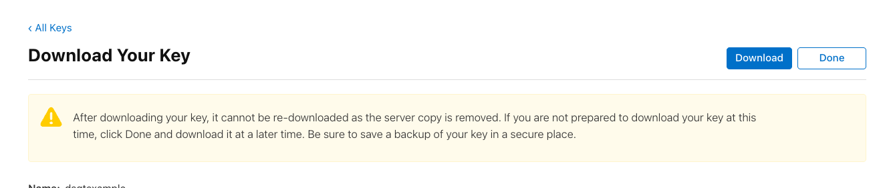


### APNs Certificate

:::note
Certificate-based provider authentication is a legacy alternative. Prefer an APNs authentication key for a new server integration. The certificate below is separate from the certificate or provisioning profile used to sign your app, and provider certificates expire.
:::


<details>
<summary>Create APNS Certificate</summary>
<p>


#### Certificate Signing Request (CSR)

This process is very similar to when you first created your developer account in the
iOS developer program. These certificates are based off the classic form of 
public-private key cryptography, but don't worry you don't need to know anything
about them to make this work. Just be aware that you will be creating certificates 
and exchanging them between the apple servers and yourself.

Most importantly you will create a certificate that is to be used to communicate from 
your server to the APNS servers. This is different and separate from your developer 
certificates you use to sign your applications. It is however “private” and you should 
not share the certificate with anyone not related to the development of these 
push notifications.

To create these certificates you create a **“Certificate Signing Request” (CSR)** and
send the CSR to a certificate issuing authority, in this case the APNS section of the 
iOS developer portal. The authority then issues you with a certificate that you can 
use to secure your communications.

On macOS you will create your CSR by using the **Keychain Access** application.
You will find this in the following location:

`Applications / Utilities / Keychain Access`

Choose the option under the main application menu (as shown in the screenshot below):

`Keychain Access / Certificate Assistant / Request a Certificate From a Certificate Authority...`

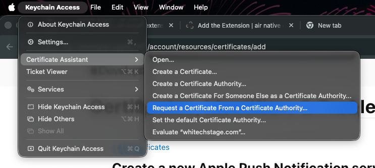

You should then be presented with a window asking for some details about the certificate request.

Here you should enter your email address, it's recommended you use the same email as
you use to sign up for the developer program but this is not essential, and a common 
name for your certificate. The common name just needs to be something descriptive to 
allow you to easily identify the certificate.

Make sure you've checked the Saved to disk option and then click Continue. Save the
file somewhere convenient, you will need it again soon.

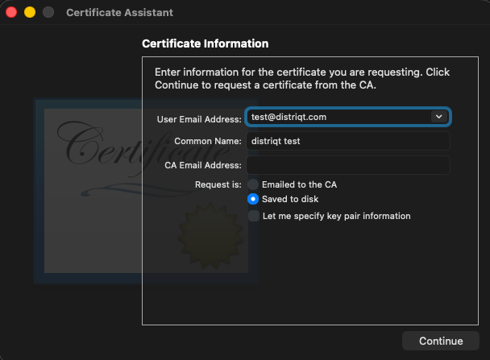


#### APNS Certificate

Open the developer dashboard

Go to "Certificates, Identifiers & Profiles"

Create a new Certificate:

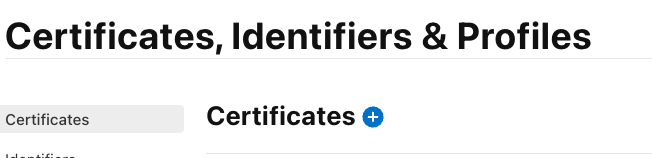


Select "Apple Push Notification service SSL (Sandbox & Production)" so you can use the same certificate with the sandbox and production or select "Apple Push Notification service SSL (Sandbox)" if you want a dedicated sandbox certificate:

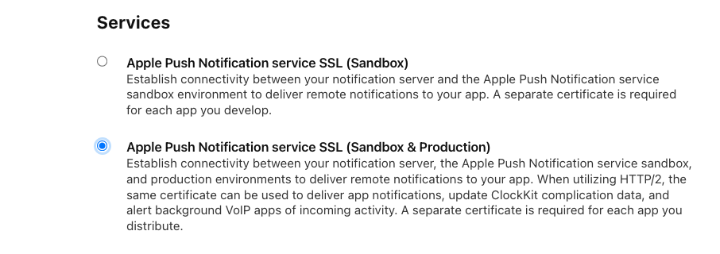

Hit Continue.

Select the application you wish to associate with this certificate. This is the application you will be able to send notifications to using APNS:

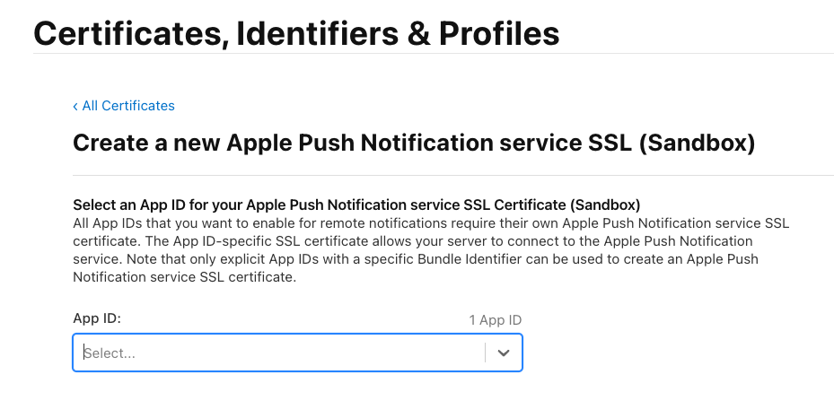


Choose the `CertificateSigningRequest.certSigningRequest` you created earlier through Keychain and upload it here:

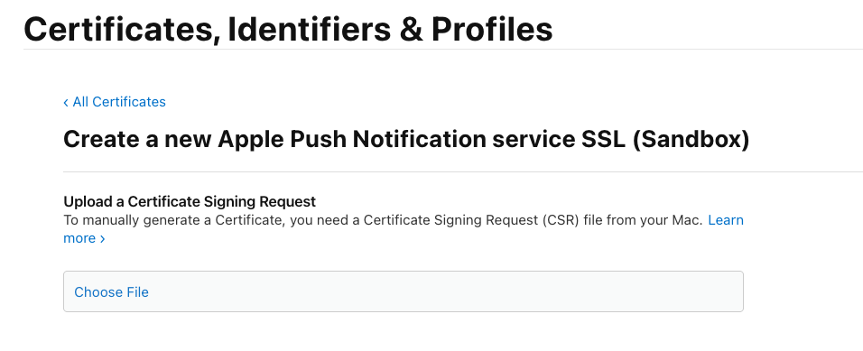

Download the certificate (it will be a `cer` file eg: `aps.cer` or `aps_development.cer`)
Open this file and it should load into Keychain so you can export it for your server (for example, as a `p12` file).


</p>
</details>


## Application Identifier


In Certificates, Identifiers & Profiles, create or edit an explicit App ID for the app. Its bundle identifier must match the identifier configured in the app and the `apns-topic` sent by your provider. Wildcard App IDs cannot be used for APNs.

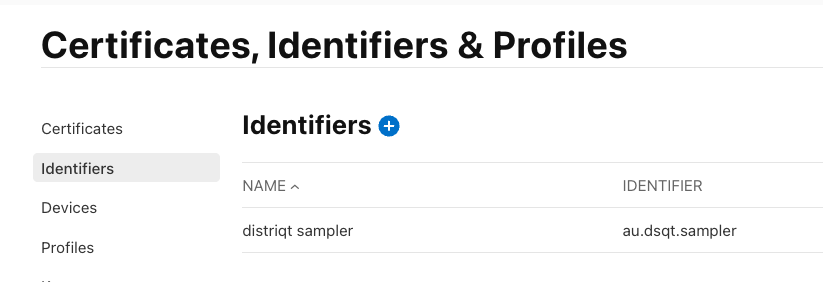


Scroll down to the "Push Notifications" capability and enable it:


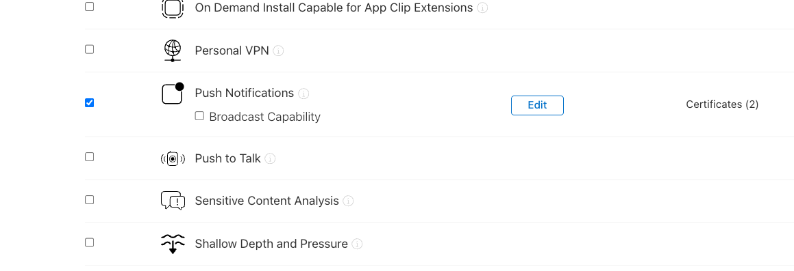


Hit Save.

Regenerate any provisioning profiles that use this App ID. Sign the app with the APNs entitlement for its platform: iOS uses `aps-environment`, while macOS uses `com.apple.developer.aps-environment`. Make sure the final signed app contains the entitlement and that its value matches the APNs environment used for testing.


The app must register with APNs using its platform's notification APIs and provide the resulting device token to your provider server over an authenticated connection. Keep the token current: it can change, and it is specific to the app and APNs environment. This guide focuses on the Apple account and provider-server setup, not app-framework registration code.


## Send a Test Notification

The repository includes a dependency-free Node.js sender at `tests/apns/nodejs`. It creates an ES256 bearer token from the `.p8` key and sends an HTTP/2 request to the APNs provider API.

From the repository root, copy the example configuration and fill in the values for the app and registered device:

```sh
cd tests/apns/nodejs
cp config.example.json config.json
```

Set `keyPath`, `keyId`, `teamId`, `bundleId`, `deviceToken`, and `environment` in `config.json`. Keep `config.json` and the `.p8` key private. Use `sandbox` for a development token and `production` for a production token; the token's environment must match the installed app's signing configuration.

Send an alert:

```sh
node send.js --title "Test notification" --body "APNs is configured"
```

The sender chooses the sandbox or production endpoint and submits a request like this (the full script also signs the bearer token and handles the HTTP/2 response):

```js
const request = client.request( {
	":method": "POST",
	":path": `/3/device/${deviceToken}`,
	"authorization": `bearer ${token}`,
	"apns-topic": bundleId,
	"apns-push-type": "alert",
	"apns-priority": "10",
	"content-type": "application/json",
} );

request.end( JSON.stringify( {
	aps: {
		alert: { title: "Test notification", body: "APNs is configured" },
		sound: "default",
	},
} ) );
```

For a background push, the sample supports `node send.js --silent`; this sends `content-available` with the `background` push type and priority 5. Background delivery is opportunistic and does not display an alert. An HTTP 200 response means APNs accepted the request; it does not confirm that the device displayed or processed the notification.


